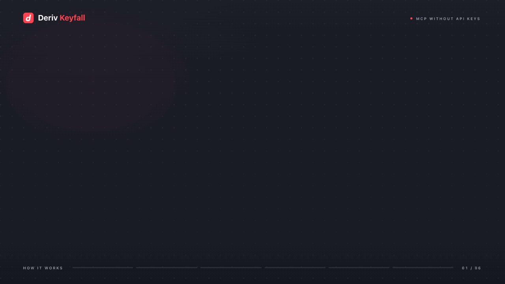
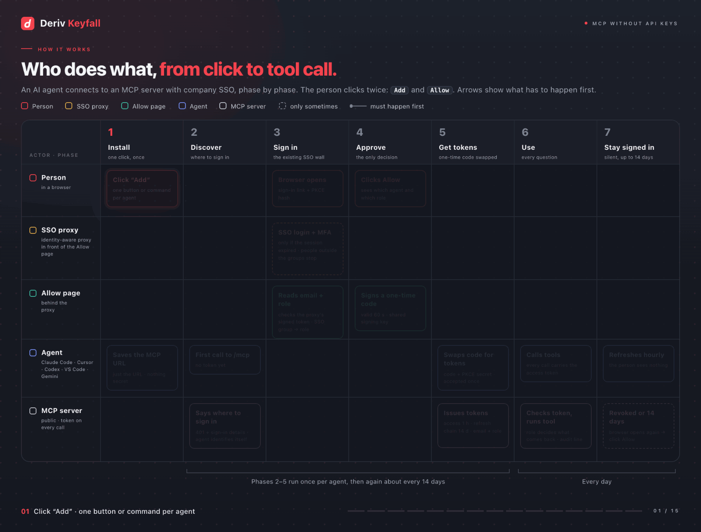

# Keyfall

**Connect AI agents to your MCP servers with your company SSO, not API keys.**

Today, connecting Claude Code, Cursor or Codex to an internal MCP server usually means pasting a
long-lived API key into a config file, where it ends up in dotfiles, git history, laptop backups
and CI logs. This repo is a reference implementation that removes those keys entirely:

- A person adds **one URL** to their agent and clicks **Allow** once, in their browser.
- Their SSO proves who they are; their SSO groups decide what the agent may do.
- The agent gets short-lived tokens: a 60-second one-time code, a 1-hour access token and a
  refresh-token chain that ends after 14 days.
- An admin can cut a person off instantly, and every tool call wrapped in `@audited` is logged.

It is plain OAuth 2.1 with PKCE, as the [MCP authorization spec](https://modelcontextprotocol.io/specification/2026-07-28/basic/authorization)
describes, so every MCP client that supports remote servers works without changes.



## Try it in 5 minutes

You need Docker (or Podman) and an MCP client such as Claude Code. No SSO is needed: the demo
uses a pretend login for `alice@example.com`.

```bash
git clone https://github.com/deriv-com/keyfall && cd keyfall/demo
docker compose up --build
```

```bash
claude mcp add --transport http demo http://localhost:8000/mcp
```

In Claude Code, run `/mcp`, pick **demo** and authenticate. A browser tab opens on the Allow
page; click **Allow**. Then ask *"use the demo server's whoami tool"*.
More in [demo/README.md](demo/README.md), including trying other roles and revoking access.

## How it works

The idea in one line: **the MCP server is public and checks tokens; the Allow page is behind
your SSO and signs a short-lived code.** The two hosts share one signing key and a Redis.

```
Agent ──(1) /mcp, no token ──────────────────▶ MCP server (public)  ──401: sign in here
Agent ──(2) opens the browser at /authorize ─▶ MCP server ──signed note──▶ Allow page (behind SSO)
Person ─(3) SSO sign-in, clicks Allow ───────▶ Allow page ──60 s code──▶ Agent (localhost)
Agent ──(4) code + PKCE secret ──────────────▶ MCP server ──▶ access + refresh tokens
Agent ──(5) every call: Bearer token ─────────▶ MCP server ──▶ tools see email + role
```



Agents can't log in to a web page, and SSO proxies only work in a browser, so the sign-in
happens in the person's browser and the result is handed to the agent through a one-time code
that only that agent can redeem (PKCE). Full walkthrough: [docs/how-it-works.md](docs/how-it-works.md).

## Use it for your own MCP server

1. Put the Allow page ([reference/allow_page.py](reference/allow_page.py)) on a host behind your SSO
   and pick the matching [login check](reference/login_check/): Cloudflare Access, Google IAP,
   Pomerium or oauth2-proxy with any OpenID Connect provider. Or write your own in a few lines.
2. Add [reference/mcp_server_auth.py](reference/mcp_server_auth.py) to your MCP server
   (Python, MCP SDK 2.x) and register your tools; `caller()` tells each tool who is calling.
3. Give both hosts the same signing key and Redis, map SSO groups to roles, and ship.

Step-by-step: [docs/setup.md](docs/setup.md). Per-client install lines: [docs/clients.md](docs/clients.md).
Prefer to have an agent do it? The [Claude Code skill](skill/keyfall/SKILL.md) walks it through.

## What's in the repo

| Path | What |
|---|---|
| `reference/mcp_server_auth.py` | MCP server side: discovery, client registration (CIMD and DCR), `/authorize`, `/token`, refresh rotation with stolen-token detection, revoke, `caller()` and an audit decorator for tools |
| `reference/allow_page.py` | The Allow page: SSO identity → role, signed one-time code, CSRF, anti-framing, fail-closed checks |
| `reference/login_check/` | "Who is signed in?" for several SSO setups, plus a demo-only fake |
| `reference/admin.py` | Who is connected, revoke or restore a person, recent events |
| `demo/` | Docker Compose demo with a fake login, and a smoke test that walks the whole flow |
| `docs/` | How it works, setup, client guides, troubleshooting, and an animated [explainer](docs/explainer/index.html) |
| `skill/` | A Claude Code skill for adding this to an MCP server |
| `tests/` | The full flow end to end, the Allow page, refresh and reuse detection, CIMD, login checks, admin |

This is **reference code**: read it, copy it, adapt it. The core sign-in flow comes from a
production deployment and every part is covered by the tests here, but it is not a library
with versioned releases.

## Security

- No API key ever reaches a laptop. The longest-lived credential is a refresh token that works
  once, in a chain that ends 14 days after Allow. Redis stores only SHA-256 hashes of access and
  refresh tokens.
- The one-time code is useless without the PKCE secret, which never leaves the agent.
- A rotated refresh token that comes back after a 30-second grace window ends the whole grant,
  so a stolen chain dies as soon as the real agent refreshes.
- The Allow page shows nothing to click unless every check passes, including the revoke list.
- By default a code may go to any https website the agent registers; set
  `MCP_WEB_REDIRECT_DOMAINS` to the ones you use ([setup](docs/setup.md#4-the-mcp-server)).

Read [docs/how-it-works.md](docs/how-it-works.md#what-protects-what) for what each piece defends
against, [docs/security-audit.md](docs/security-audit.md) for the pre-release security review, and
[SECURITY.md](SECURITY.md) to report a vulnerability.

## Run the tests

```bash
python -m venv .venv && .venv/bin/pip install -r requirements-dev.txt
.venv/bin/python -m pytest -q
```

## License

MIT. See [LICENSE](LICENSE).
