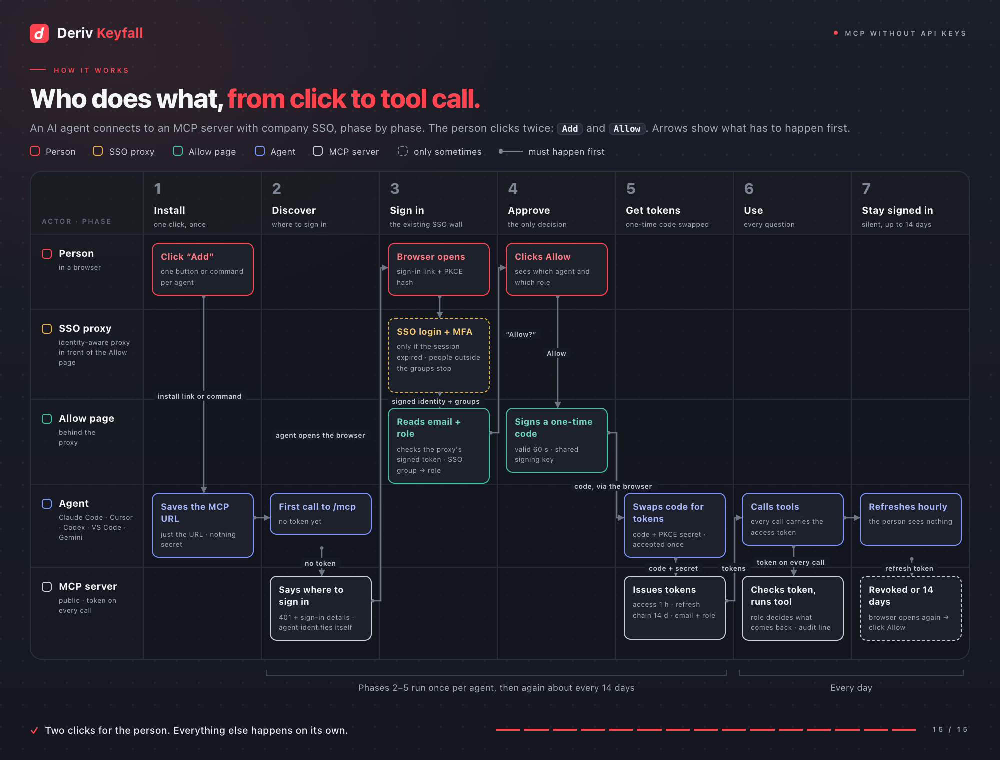
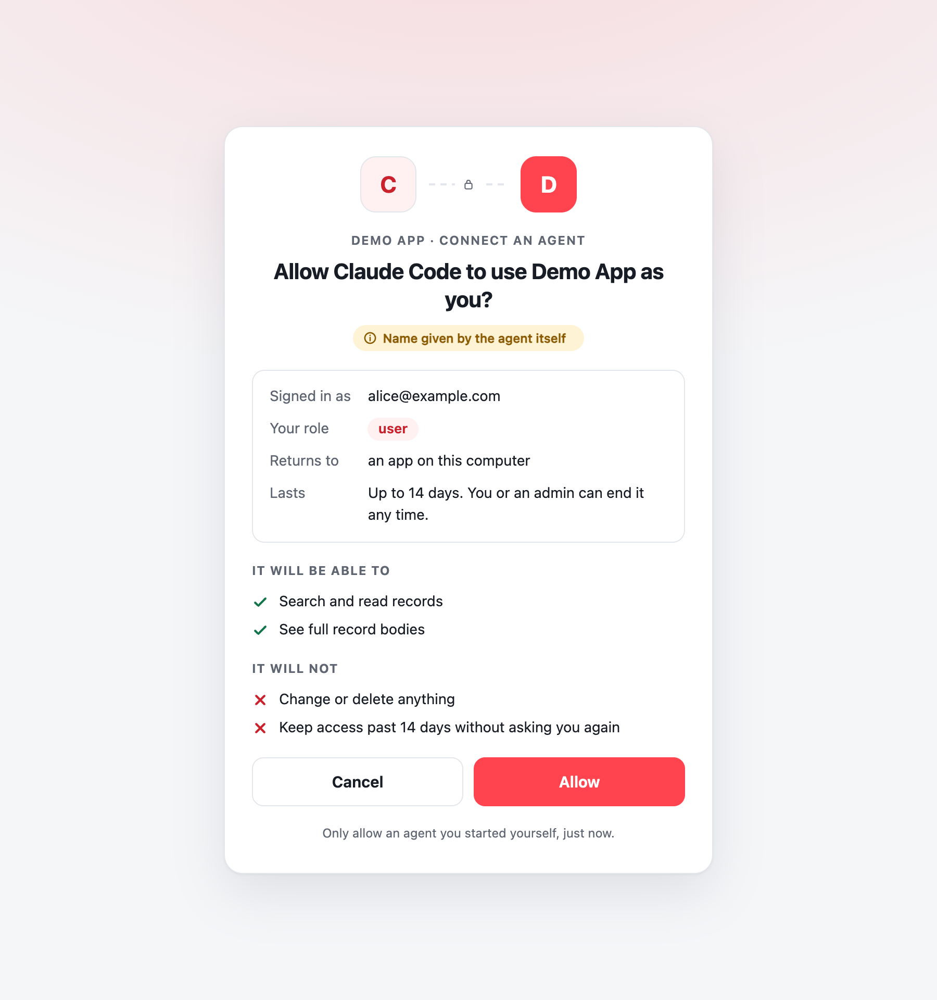
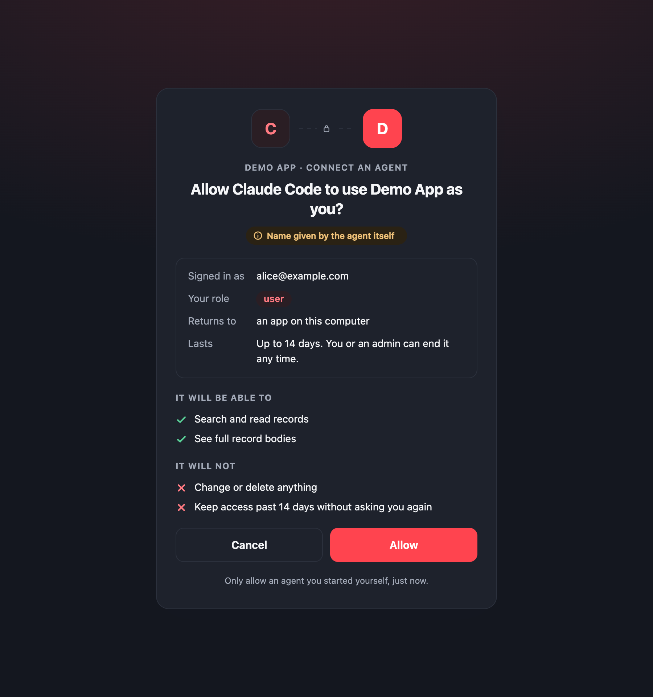

# How it works

The Allow page people see (light and dark):

 

## The one idea

AI agents talk to an MCP server **from code**: they have no browser, no cookies and can't type
a password. SSO, on the other hand, only works **in a browser**. So the sign-in is split across
two hosts:

| Host | Behind SSO? | Serves |
|---|---|---|
| **MCP server** (`<mcp-host>`) | **No.** Public; every `/mcp` call needs a bearer token. | `/mcp`, `/.well-known/*`, `/register`, `/authorize`, `/token`, `/revoke` |
| **Allow page** (`<approval-host>`) | **Yes.** An identity-aware proxy (or your app's own login) in front. | `GET/POST /connect-agent/authorize` |

SSO only ever happens on the Allow page. The MCP server has no SSO integration, no client
secret and no idea which SSO you use: it trusts a 60-second code that the Allow page signs. The
two hosts share **one signing key** (HS256, at least 32 bytes) and **one Redis** (for used codes,
tokens, revoke flags and the audit trail). Nothing else.

If the MCP server sat behind the SSO proxy too, the agent's first call would get an HTML login
page instead of JSON and fail. Quick check: `curl -i -X POST https://<mcp-host>/mcp` must answer
**401 from your server**, not a login page.

## Step by step

The people and programs involved: **Alex** (a person), **Alex's browser**, **the agent** (e.g.
Claude Code, on Alex's laptop), **the MCP server**, **the SSO** and **the Allow page**.

### 0. Setup (once, by your team)
1. Create SSO groups per role, e.g. `mcp-admin`, `mcp-user`, `mcp-readonly`.
2. Put the Allow page's host behind your SSO proxy, allowing those groups.
3. Generate one signing key; give the same value to both hosts. Point both at the same Redis.
4. Keep the MCP server's host public.

### 1. Alex adds the server (click 1)
`claude mcp add --transport http my-app https://<mcp-host>/mcp`. The config holds only the URL.

### 2. Discovery (agent ↔ MCP server, direct HTTPS)
1. `POST /mcp` with no token → **401** with `WWW-Authenticate: Bearer resource_metadata="…/.well-known/oauth-protected-resource/mcp"`.
2. That document says the sign-in server is the MCP server itself.
3. `/.well-known/oauth-authorization-server` lists `/authorize`, `/token`, `/register`, `/revoke`,
   allows only PKCE `S256`, and says `client_id_metadata_document_supported: true`.
4. The agent identifies itself, one of two ways:
   - **CIMD** (Client ID Metadata Document, preferred by the current MCP spec): its `client_id`
     is an https URL its vendor hosts, serving a small JSON file with its name and redirect
     URIs. Nothing is registered. The Allow page names the publishing domain, but says
     "Verified" only when the callback is an https page on that same domain: any app on the
     laptop could start a sign-in with a well-known vendor's `client_id` and its own localhost
     listener.
   - **DCR** (Dynamic Client Registration, the older way most agents still use):
     `POST /register` with its name and callback address → a `client_id`, kept 90 days.
   Either way the callback address must pass the callback rules: this computer (`localhost`),
   a listed app callback, or a website listed in `MCP_WEB_REDIRECT_DOMAINS`.

### 3. The agent prepares (on Alex's laptop)
1. Makes a random **secret** (PKCE `code_verifier`) and keeps it in memory.
2. Computes its **hash**: `code_challenge = base64url(SHA-256(secret))`.
3. Starts a small listener on `http://localhost:<port>/callback` and makes a random `state`.
4. Opens Alex's browser at `<mcp-host>/authorize?client_id=…&redirect_uri=…&code_challenge=<hash>&code_challenge_method=S256&state=…`.

### 4. The MCP server hands off
1. Checks the client, the callback address and `S256`.
2. Signs the **signed note** (request token, 10 minutes): agent id and name, callback address,
   the **hash**, `state`.
3. Redirects the browser to `<approval-host>/connect-agent/authorize?req=<signed note>`.

### 5. SSO and the Allow page (in Alex's browser)
1. The SSO proxy signs Alex in if needed (people outside the allowed groups stop here) and
   passes a signed identity token to the Allow page.
2. The Allow page checks that token ([login_check](../reference/login_check/)) and maps Alex's
   groups to a **role**: exact match, highest role wins.
3. It checks the signed note (signature, audience, age, `S256`, callback address) and Alex's
   **revoke flag**. If any check can't be made, there is no Allow button.
4. It shows: who is signed in, the role, the agent's name (verified or self-declared), where the
   code will go, what the agent can and can't do. The form carries a CSRF token tied to Alex
   and this signed note; the page can't be framed or cached.

### 6. Alex clicks Allow (click 2)
1. The Allow page checks the CSRF token and the revoke flag again.
2. It signs the **one-time code** (60 seconds, random id): Alex's email and role, plus the agent
   id, callback address and **hash** copied from the signed note.
3. It redirects the browser to `http://localhost:<port>/callback?code=…&state=…&iss=…`; the
   agent's listener receives it and checks `state` and `iss` (the MCP server's issuer).

### 7. Tokens (agent ↔ MCP server, direct HTTPS)
1. `POST /token` with the **code and the secret itself**. This is the only time the secret leaves
   the agent.
2. The MCP server checks: signature (shared key), audience (a code, not a note), under 60 s
   old, same agent and callback, revoke flag, **used once** (`SET code-used:<id> NX`), and
   **PKCE**: `SHA-256(secret)` equals the hash inside the code.
3. It starts a **grant** (this Allow, up to 14 days) and issues an **access token** (1 hour)
   and a **refresh token**. Redis keeps only their SHA-256 hashes.

### 8. Using it
Every `/mcp` call carries `Authorization: Bearer <access token>`. The server looks it up, checks
the revoke flag and hands the tools Alex's email and role (`caller()`). Tools hide what the role
may not see, on the server, and every call to a tool wrapped in `@audited` is written to the
audit trail.

### 9. Staying signed in, and the end
- **Every hour** the agent swaps its refresh token for a new pair, silently. Each refresh token
  works once; the chain keeps the same end date.
- **Day 14**: the chain ends; Alex clicks Allow again, and the SSO groups are read again.
- **Revoke**: an admin runs `admin.py revoke` and Alex's next call, refresh or code is refused.

## The credentials and their timers

| Credential | Made by | Carried to | Lives | Notes |
|---|---|---|---|---|
| Signed note (request token) | MCP server | Allow page, via the browser | 10 min | time to sign in and click Allow |
| One-time code | Allow page | the agent, via the browser | 60 s, once | useless without the PKCE secret |
| PKCE secret | the agent | MCP server, once, direct | one sign-in | never in a URL |
| Access token | MCP server | sent on every call | 1 hour | |
| Refresh token | MCP server | `/token` only | used once; the chain ends at 14 days | replaced on every refresh |

Both signed tokens are HS256 JWTs with **different issuers and audiences**, so a code can never
be replayed as a signed note or the other way round. Their exact claims are at the top of
[allow_page.py](../reference/allow_page.py).

## PKCE in plain words

The code travels in a URL, and URLs leak (browser history, logs, another app on the laptop
listening on the same port). Agents can't keep a client secret either: anything shipped to every
laptop isn't secret. PKCE fixes both: before signing in, the agent picks a secret and publishes
only its hash; to redeem the code it must present the secret itself. A thief with the code has
no secret, and SHA-256 can't be reversed to find it.

## Refresh tokens: rotation, grace and reuse detection

- **Rotation.** Each refresh returns a new access token *and* a new refresh token; the old pair
  stops working.
- **Grace (30 s).** Several windows of one agent often refresh the same token in the same
  second. During 30 seconds after a rotation, the old token returns the *same* new pair (stored
  encrypted with a key derived from the old token, so only its holder can read it) instead of
  failing.
- **Reuse detection.** After the grace window, an old refresh token coming back means two
  parties hold the chain, so one of them stole it. The server can't tell which, so it **ends the
  whole grant** (OAuth security best practice, RFC 9700 §4.14.2): the thief is cut off and the
  person clicks Allow again. Set `MCP_REFRESH_REUSE_ACTION=log` to only record it if this logs
  people out too often in your environment (for example an agent window that sleeps for hours
  holding an old token).
- **Fixed end date.** Every refresh token in a chain expires when the grant does, never later.

## What protects what

| Threat | What stops it |
|---|---|
| API key copied from a laptop, repo or backup | there is none; nothing long-lived is stored on the laptop |
| Code stolen from a URL, history or log | PKCE: the code is useless without the secret |
| Agent tricked into sending the code elsewhere | callback rules (this computer, a listed app callback or a listed website), checked at registration, `/authorize` and on the Allow page, with one reading for every URL parser (no `\`, `user@`, `%` in the host or control characters); the code is bound to the callback |
| A link to the Allow page for someone else's agent (consent phishing) | the page names where the code goes and whether the agent's name is verified; Allow can't be hit by a stray Enter or in the first 0.7 s; a website receives codes only when listed in `MCP_WEB_REDIRECT_DOMAINS`, so a stranger's own site never gets one |
| The public host used as an open redirector | `/authorize` errors for a website callback are answered on the MCP host, never redirected |
| An agent using several servers sends a code to the wrong one (mix-up) | every authorization response carries `iss` (RFC 9207), advertised in the metadata, so the agent can check which server answered |
| Someone tampers with the request in the browser | the signed note: changing the callback or hash breaks the signature |
| A local app pretending to be a well-known agent | "Verified" only for https callbacks on the vendor's own domain; otherwise no badge, and "Only allow an agent you started yourself, just now" |
| Using the server to fetch internal URLs (CIMD) | https on port 443 only, printable ASCII URLs, no IP literals, every resolved address must be public (also an IPv4 address inside IPv6, such as NAT64) and the connection goes to that checked address (no DNS rebinding), no redirects, no compressed bodies, 10 KB cap, 5 s for the whole download; `MCP_CIMD_TRUSTED_HOSTS` to allow only known vendors |
| Dodging the blocked-domain list (`example.com.`) | host names are compared without the trailing dot; metadata URLs ending in a dot are refused |
| Clickjacking the Allow button | `frame-ancestors 'none'`, `X-Frame-Options: DENY`; the buttons ignore clicks for 0.7 s (double-click hijacking) and none has focus on load |
| A forged Allow submission | CSRF token tied to the person and the signed note |
| A forged code | HS256 signature with the shared key; distinct audiences |
| A code used twice | `SET code-used:<id> NX` |
| A stolen refresh token | rotation + reuse detection end the chain; every token is checked against its grant, so a refresh in flight when the grant ends can't revive it; 14-day cap |
| A person who should lose access now | admin revoke: flag checked on every code, refresh and call |
| A person removed from the SSO group | access ends when their grant ends (at most 14 days); revoke for immediately |
| Redis down during approval | fails closed: no Allow button |
| Redis filled up through the open `/register` | each registration is capped (10 callbacks, 8 KB); run Redis with `maxmemory-policy noeviction` so revoke flags are never evicted, and rate-limit the public endpoints at the proxy |
| A tool leaking data a role shouldn't see | the role is enforced on the server inside each tool |

What it does **not** protect against: malware on the person's laptop that reads the agent's
memory or token store, a compromised SSO account, or a malicious agent the person chooses to
allow, including one that arrives as a link they didn't start. The Allow page's "Only allow an
agent you started yourself, just now" line is there for the last one; and because websites must
be listed, a stranger's link can only send the code back to the person's own computer. The full review is in [security-audit.md](security-audit.md).
